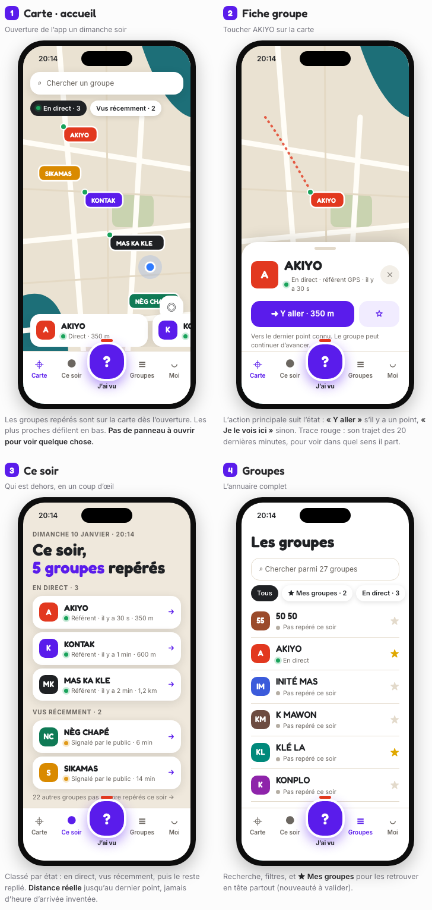
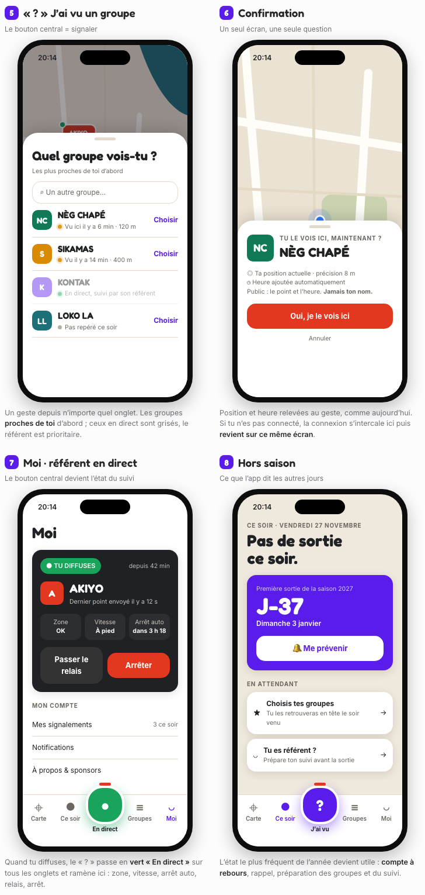

# PRD — Parcours et navigation de l’app mobile 2027

Rédigé le 27 novembre 2026, après la revue UI/UX de l’app Expo servie sur `develop` (`c489ced`) et les arbitrages de Marvin le même jour. Ce document fixe la direction validée. Il ne décrit pas l’implémentation actuelle (voir [refonte-2027.md](./refonte-2027.md)) et ne remplace pas le vocabulaire métier de [CONTEXT.md](../../../CONTEXT.md).

Statuts utilisés ci-dessous :

- **Validé** : arbitré par Marvin, à réaliser.
- **À décider** : idée retenue dans la direction, mais une règle métier, une donnée ou un coût reste à trancher avant réalisation.

## Pourquoi on reprend

L’app actuelle est une carte avec un panneau par-dessus. Constats de la revue :

- Sans groupe dehors, la carte n’affiche rien et l’app ne dit pas quoi faire. C’est l’état le plus fréquent de l’année.
- Il n’existe pas d’endroit pour accéder aux différentes sections. « Mon espace » et le titre « Omasla » occupent le haut sans aider.
- L’action à mettre en avant (ajouter une position) n’est visible qu’à l’intérieur d’une fiche groupe.
- L’identité visuelle (bleu iOS, gris) n’a plus rien de l’Omasla d’origine : couleurs du logo, violet du site, bouton principal évident.
- Le ton mélange tutoiement (carte) et vouvoiement (déclaration, compte).

Le contexte terrain guide les choix. Le dimanche soir, pendant la saison (du premier dimanche de janvier au carnaval), la plupart des groupes sortent. Chaque groupe suit **son propre itinéraire** : départ à son heure, arrêts selon ses traditions, pauses plus ou moins longues. Il n’y a pas de parcours officiel commun et les sorties se croisent. **La carte reste donc l’outil principal pour repérer les groupes.** Une vue « cortège » linéaire a été étudiée puis écartée pour cette raison.

## Qui vient faire quoi

| Qui                | Quand                                    | Ce qu’il veut                                                                   |
| ------------------ | ---------------------------------------- | ------------------------------------------------------------------------------- |
| Spectateur         | Dimanche soir, dans la foule, à une main | Voir qui est dehors, où est son groupe, y aller                                 |
| Spectateur         | En semaine, hors saison                  | Retrouver ses groupes, savoir quand ça reprend                                  |
| Contributeur       | Un groupe passe devant lui               | Ajouter sa position en quelques gestes                                          |
| Membre d’un groupe | Avant, pendant et après la sortie        | Diffuser la position du groupe, savoir que ça tourne, passer le relais, arrêter |
| Partenaire         | Toute la saison                          | Être visible : stand, offre, soutien                                            |

Actions mises en avant, dans l’ordre :

1. Repérer un groupe et y aller.
2. Voir ce qui se passe ce soir.
3. Ajouter une position.
4. Diffuser la position de son groupe.

## Navigation — validé

Barre d’onglets en bas, avec un bouton central :

| Carte | Ce soir | **+** | Groupes | Moi |
| ----- | ------- | ----- | ------- | --- |

- **Carte** est l’onglet d’accueil.
- **Bouton central « + » : ajouter une position.** Il est accessible depuis tous les onglets. Le « ? » des premières maquettes est abandonné, car il ne disait pas « ajouter ».
- **Pour un membre qui diffuse**, le bouton central devient l’état du suivi : vert, « En direct ». Il ouvre alors les commandes du suivi au lieu de l’ajout.
- **Les panneaux glissants (bottom sheets)** restent des couches de contexte : fiche, résultats, ajout. Ce ne sont plus des éléments de navigation.
- **Le tutoiement** s’applique partout.

### Vocabulaire de l’interface

- **Validé** : l’interface parle de **membre du groupe** et non de « référent ».
- **À décider** : faut-il aussi renommer le terme métier « référent habilité » de CONTEXT.md, la console et les API, ou garder ce terme en interne seulement ?

## Maquettes

Premières maquettes (positions, distances et horaires fictifs ; noms de groupes réels du DEV). Elles montrent encore le « ? » central et le mot « référent » : à mettre à jour avec le « + » et « membre du groupe ».

## Parcours

### P1 — Repérer un groupe et y aller (validé)

1. **Carte à l’ouverture.**
   - Les groupes repérés s’affichent en plaques de couleur, avec une pastille quand ils sont en direct.
   - En haut : une recherche et des filtres (« En direct · n », « Vus récemment · n »).
   - En bas : un carrousel des groupes repérés.
2. **Toucher une plaque** ouvre la fiche du groupe.
   - Elle affiche son nom, l’état de sa position, la source et l’âge du point.
   - L’action principale dépend de l’état :
     - **« Y aller »** s’il existe un point encore valable : itinéraire piéton externe, avec le rappel que le groupe peut avancer ;
     - **« Je le vois ici »** s’il n’y a pas de point et pas de direct : ouvre P3 avec ce groupe déjà choisi ;
     - pendant un direct, l’ajout est indisponible, avec une explication.
3. **La distance** jusqu’au point n’apparaît que si le spectateur s’est déjà localisé. Pas d’heure d’arrivée estimée.

### P2 — Ce soir (validé)

- **Pendant une sortie**, les groupes sont classés par état :
  1. en direct ;
  2. vus récemment ;
  3. pas encore repérés (section repliée).
- **Les autres jours** (voir P7), l’écran affiche le compte à rebours et ce qu’on peut faire en attendant.

### P3 — Ajouter une position avec « + » (validé)

1. **« Quel groupe vois-tu ? »**
   - Les groupes dont le dernier point est proche viennent en premier, puis la recherche.
   - Les groupes en direct sont grisés : le membre du groupe est prioritaire.
2. **Confirmation.** « Tu le vois ici, maintenant ? »
   - La position et l’heure sont relevées au geste.
   - Rappel public : le point et l’heure sont visibles, jamais le nom.
3. **Publication**, puis confirmation et retour à la carte, centrée sur le point.

Règles conservées : position actuelle uniquement, aucune saisie manuelle, aucune publication différée, permission demandée au geste.

### P4 — Connexion et création de compte (validé, existant à réhabiller)

- **Moyens de connexion :** Apple, Google, et e-mail par lien sans mot de passe. Le compte se crée à la première connexion.
- **Points d’entrée :**
  - l’étape 2 de P3 (ajouter une position) ;
  - la diffusion (P5) ;
  - l’onglet **Moi**.
- **Retour après connexion :** on revient exactement à l’écran d’origine. Rien n’est publié automatiquement au retour.
- **Consultation :** tout reste accessible sans compte.
- **À couvrir aussi :**
  - l’échec et l’annulation de la connexion ;
  - le cas hors ligne ;
  - la déconnexion, qui arrête d’abord la diffusion.

### P5 — Membre d’un groupe : diffuser (validé)

- **Démarrer** depuis Moi, uniquement si on est habilité pour ce groupe.
- **Pendant la diffusion :**
  - le bouton central devient « En direct » sur tous les onglets ;
  - l’écran Moi affiche une carte d’état : groupe, durée, dernier point envoyé, zone, vitesse, échéance de l’arrêt automatique.
- **Commandes :** passer le relais, arrêter.
- **Arrêts automatiques** (zone, vitesse, durée) : expliqués dans l’app et par une notification locale, comme aujourd’hui.

### P6 — Plusieurs membres diffusent pour un même groupe (à décider)

Demande de Marvin : dans un grand groupe, plusieurs membres répartis dans le cortège doivent pouvoir diffuser. On représente alors l’étendue réelle du groupe (tête, queue, taille), et non un seul point.

**C’est contraire à la règle actuelle** « un seul émetteur actif, passation explicite » (CONTEXT.md, MAR-396, MAR-410). À trancher :

- **Modèle d’émission :**
  - soit plusieurs émetteurs simultanés ;
  - soit une rotation (« round robin ») où les membres émettent à tour de rôle, ce qui économise la batterie de chacun.
- **Représentation :**
  - tête et queue ;
  - emprise le long de la rue ;
  - ou zone englobante lissée ;
  - avec la règle de fraîcheur pour chaque point.
- **Effets sur les sessions** : passation, arrêts automatiques, blocage des déclarations publiques, console de la permanence.

### P7 — Hors saison et soirs sans sortie (validé)

- **Compte à rebours vers la prochaine sortie.** En 2027, la première sortie est le dimanche 3 janvier (règle : premier dimanche de janvier).
- **Raccourcis « En attendant » :** choisir ses groupes, préparer sa diffusion.
- **Emplacement partenaires** (voir plus bas).
- **« Me prévenir » (à décider)** : demande des notifications push, absentes aujourd’hui. Seules des notifications locales existent pour la diffusion.

### P8 — Hors ligne (validé, existant)

- Les dernières données chargées restent consultables, avec leur âge.
- L’ajout et la diffusion sont bloqués, avec une explication.
- Rien n’est envoyé automatiquement à la reconnexion.

## Au-delà des groupes : la carte de la soirée — à décider

Objectif : « voir grand ». La carte affichera d’autres éléments que les groupes, par couches que l’on peut filtrer :

- vendeurs ambulants ;
- manger et boire ;
- points de sécurité et de secours ;
- toilettes ;
- stands et emplacements des partenaires ;
- d’autres catégories à venir.

À cadrer :

- le modèle de données (point fixe ou mobile, horaires, saisonnalité) ;
- qui saisit et modère (console de la permanence ou partenaires eux-mêmes) ;
- la priorité visuelle face aux groupes, qui restent l’information principale ;
- les filtres sur la carte et leur place dans « Ce soir ».

## Partenaires — à décider

Emplacements prévus :

- l’écran hors saison ;
- la carte (stands, points partenaires) ;
- les listes (Ce soir et Groupes, insertion mesurée).

Reprend le bloc « Deviens sponsor » de l’ancien site. Dépend de l’offre partenaires (MAR-358) et du reporting (MAR-360).

## Tracés des groupes — à décider

- **Afficher le trajet récent d’un groupe** sur sa fiche, par exemple les 20 dernières minutes. Il donne le sens de déplacement. Cela rend public un historique court : la politique de fraîcheur et de confidentialité est à revoir.
- **Le tracé doit suivre les rues.** Quand deux points sont éloignés, on reconstitue le chemin piéton le plus simple au lieu d’une ligne droite. Pistes :

  - recalage sur le réseau routier (« map matching ») avec OSRM, Valhalla ou l’API Map Matching de Mapbox ;
  - calcul d’itinéraire piéton entre deux points trop espacés ;
  - simplification du tracé côté serveur.

  Ces pistes sont à évaluer selon le coût, l’hébergement et la qualité sur le réseau de Pointe-à-Pitre.

## Identité visuelle — à décider

- **Base :** les couleurs du logo actuel (crème `#EFE8DC`, encre `#1F2124`, violet `#5A1CEB`, rouge `#E2381F`), le lettrage rond, et une « plaque » de couleur par groupe.
- **Logo :** le logo actuel vient de Canva, sans source vectorielle. Un premier redessin en SVG a été jugé trop peu vivant. Une nouvelle passe est à faire, avec les déclinaisons logotype, symbole rond, icônes d’app, fonds noir et blanc.
- **Couleurs des groupes :** les vraies couleurs ou emblèmes sont à collecter auprès des groupes.

## Données de test en DEV — à décider

Pour éprouver ces parcours hors sortie, deux options, toujours sans écriture en PROD :

- **Rejouer en DEV des sessions réelles des saisons passées** : export en lecture seule, identités retirées, données étiquetées « rejeu ». Nécessite l’accord explicite de Marvin pour lire la PROD.
- **Simuler** des sessions et des déclarations sur des itinéraires plausibles.

## Tickets Linear

EPIC [MAR-448](https://linear.app/marvinl/issue/MAR-448). Validés (À faire) :

- MAR-450 Barre d’onglets et bouton central « + »
- MAR-451 Carte d’accueil : plaques, filtres, carrousel
- MAR-452 Fiche groupe : action principale selon l’état
- MAR-453 Ce soir et état hors saison
- MAR-454 Onglet Groupes et « Mes groupes »
- MAR-455 Ajouter une position via « + »
- MAR-456 Connexion et création de compte
- MAR-457 Espace membre du groupe
- MAR-458 « Membre du groupe » et tutoiement

À décider (Backlog) :

- MAR-459 Identité visuelle et logo v2
- MAR-460 Plusieurs membres qui diffusent
- MAR-461 Tracés recalés sur les rues
- MAR-462 Services et points d’intérêt sur la carte
- MAR-463 Emplacements partenaires
- MAR-464 Notifications « Me prévenir »
- MAR-465 Données DEV rejouées ou simulées

## Hors périmètre de ce document

- La signature, la publication sur les stores et la validation du GPS écran verrouillé sur téléphones physiques (MAR-349, MAR-351).
- Les règles d’arrêt, la passation et la console, déjà décrites par l’EPIC MAR-344, sauf leur remise en cause par P6.
