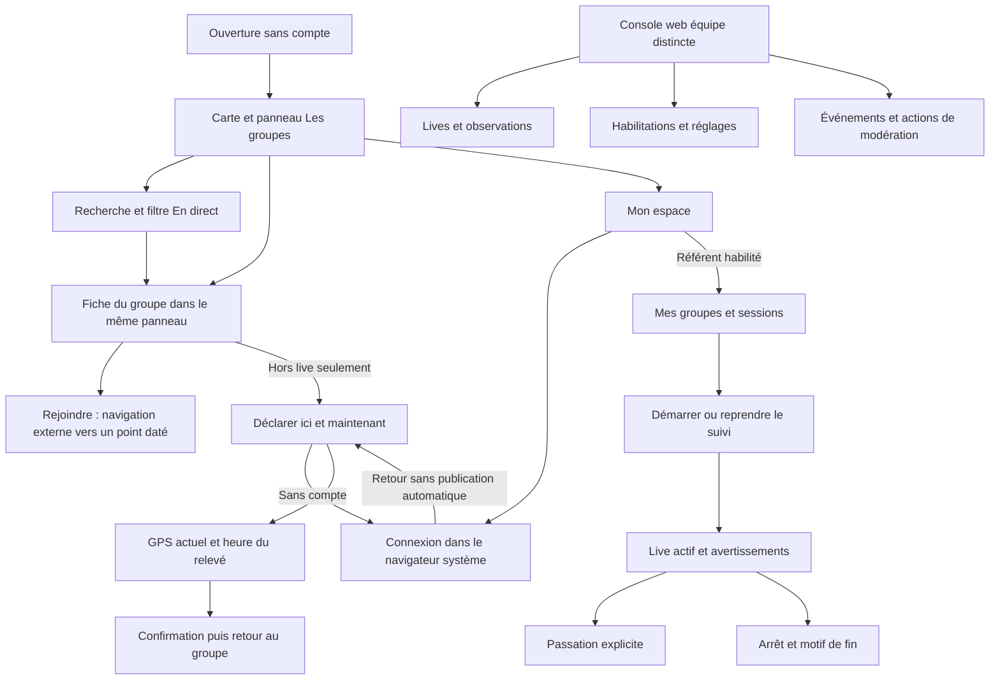

# Omasla — écrans, parcours et périmètre V1

Inventaire du 20 octobre 2026, établi sur le code de `develop` après la refonte du 14 octobre. La planche [interactive](visuals/omasla-app-map.html) est un wireframe explicatif : ses données sont fictives, ses compositions simplifiées et ses propositions ne sont pas des fonctionnalités livrées.

## La promesse et la navigation

Ouvrir Omasla pendant le carnaval, retrouver un groupe à partir d’une position compréhensible et récente, puis rejoindre son dernier point connu. L’échéance décidée est le 1er janvier 2027, sur iOS et Android.

Le choix validé est une carte persistante avec un seul panneau pour la recherche, la liste et la fiche du groupe. Ces trois états partagent le même contexte spatial. Sur iPad, le panneau devient latéral. Il n’y a actuellement ni barre d’onglets ni menu latéral. L’icône personne en haut à droite ouvre « Mon espace » ; son accès est trop discret pour expliquer à lui seul tous les rôles de l’app.

Recommandation UX à valider : conserver cette composition pour la V1, rendre l’accès à « Mon espace » plus explicite et distinguer le compte spectateur du mode référent. Ajouter des onglets Carte et Groupes dupliquerait aujourd’hui deux états du même panneau. Des onglets pourront devenir pertinents lorsque de vraies destinations supplémentaires auront été décidées.

## Vue éclatée

## Écrans et états déjà codés

« Codé » signifie présent dans le dépôt. Cela ne signifie ni activé chez les fournisseurs, ni validé sur tous les appareils, ni publié dans les stores.

| Surface               | Fonctions                                                                                                            | Entrée / rôle                                                          |
| --------------------- | -------------------------------------------------------------------------------------------------------------------- | ---------------------------------------------------------------------- |
| Carte et découverte   | Bannières, positions datées, vue d’ensemble, recentrage personnel sur demande, 2D/3D, sources IGN, jour/nuit         | Ouverture ; consultation sans compte et sans permission GPS            |
| Recherche et annuaire | Recherche sans accents, tous les groupes / en direct, liste agrandie, résultat vide, groupes sans position conservés | Panneau de la carte ; public                                           |
| Fiche d’un groupe     | Nom, emblème, source, statut, âge, Rejoindre si le point est encore utilisable, déclaration si hors live             | Bannière ou ligne ; public                                             |
| Déclaration           | GPS neuf et heure du relevé au geste, états permission/acquisition/publication, confirmation, réessai sans doublon   | Fiche hors live ; compte requis                                        |
| Mon espace            | Connexion, identité, déconnexion, habilitations et suivi pour les référents                                          | Icône personne ; contenu selon compte                                  |
| Connexion et retour   | Google, Apple et e-mail par lien ; ouverture du navigateur système ; retour vers la destination autorisée            | Mon espace ou déclaration ; fournisseurs réels à configurer et exercer |
| Mes groupes référents | Groupes habilités, démarrage, permissions nécessaires, session en cours                                              | Dans Mon espace ; habilitation par groupe                              |
| Suivi actif           | Arrêt, reprise sur le même téléphone, limite de durée, état de collecte, avertissement vitesse, événements récents   | Dans Mon espace ; émetteur actif                                       |
| Passation et fin      | Proposition, attente, annulation, acceptation explicite, derniers motifs d’arrêt                                     | Dans Mon espace ; référents autorisés                                  |
| Console équipe        | Lives, arrêt forcé, observations et retrait, habilitations, réglages, événements                                     | Site web `/admin` ; modération/admin                                   |

La fiche distingue le live référent, une observation communautaire et l’absence de point utilisable. Une position périmée ne produit pas d’itinéraire inventé. Un live actif bloque les déclarations, même lorsque son dernier relevé a vieilli. Le prochain point du référent reste prioritaire.

Les seules routes mobiles rendant une surface sont `/`, `/observe`, `/account` et `/login`. `/home` redirige vers `/` et `/group/[id]` rouvre la même carte avec le groupe sélectionné. Le formulaire de connexion et « Consultez votre boîte mail » sont des pages web du parcours d’authentification, pas des formulaires natifs distincts.

## Droits et fonctionnement

- **Spectateur** : lire sans compte ; déclarer hors live après connexion. La déclaration utilise le téléphone ici et maintenant, sans point déplacé ni heure saisie.
- **Référent habilité** : un seul téléphone émetteur actif par session ; plusieurs référents possibles par groupe ; passation explicite.
- **Modération** : arrêter les lives, retirer les observations, habiliter/révoquer les référents et changer les paramètres de suivi.
- **Administrateur** : mêmes fonctions et attribution des rôles de l’équipe. Cette dernière action n’appartient pas à tous les modérateurs.

La console est actuellement web. L’app mobile ne contient pas de menu de modération ni de gestion mobile des droits.

## États transversaux à compter dans le produit

- Réseau faible : consulter le catalogue déjà chargé, avec âge et état hors ligne ; aucune contribution différée.
- Premier démarrage hors ligne : pas de données inventées lorsque le cache est vide.
- Permission GPS refusée : la consultation reste disponible ; réessayer ou accéder aux réglages pour les actions qui en ont besoin.
- Connexion interrompue ou expirée : retour explicite et aucun envoi automatique.
- Groupe sans position, position ancienne, zéro résultat, erreur de service : messages et reprise adaptés.
- Live : arrêt manuel, durée maximale, zone adaptable autour de Pointe-à-Pitre, vitesse persistante après avertissement. Seuils et consommation batterie à calibrer sur le terrain.
- Accessibilité : taille de texte, actions accessibles du panneau, contraste jour/nuit et réduction de transparence. Leur présence dans le code ne remplace pas la recette sur appareils.

Le cache public ne constitue pas un téléchargement hors ligne de la carte. L’itinéraire externe vise un point daté ; Omasla ne prédit pas la trajectoire du groupe ni les rues fermées pour le carnaval.

## Ce qui reste à terminer ou valider

1. **Clarté de l’espace public.** Le compte affiche aujourd’hui « Mes groupes à suivre » et un message d’absence d’habilitation même à un spectateur. Séparer clairement les usages public/référent et rendre les accès visibles est une proposition UX, pas une modification livrée par cet inventaire.
2. **Compte et information.** Activation réelle Google/Apple/e-mail ; parcours de suppression de compte et informations de confidentialité adaptées à l’app ; accès aide/sources. Les pages historiques du site ne prouvent pas que ces besoins mobiles sont couverts.
3. **Recette native.** Clavier logiciel, glissement du panneau après la migration MapLibre, VoiceOver parlé, parcours Android et appareils physiques, GPS écran verrouillé, autonomie et passation sur le terrain.
4. **Exploitation.** Organisation de la permanence, groupes participants, calibration des seuils, migration des données existantes et publication stores.

Les preuves du 14 octobre couvrent notamment sélection bannière→fiche, recherche→sélection→retour, 2D/3D, attribution et capture sombre sur iOS. Cet audit du 20 octobre est une relecture du code et de ces preuves ; il ne prétend pas avoir rejoué la recette native.

## Pistes futures, hors V1 approuvée

Favoris, agenda des sorties, notifications au public, pages de groupe enrichies, parcours de défilé, partage social, cartes téléchargeables et navigation guidée dans l’app. Aucun de ces sujets ne doit être présenté comme livré ou ajouté automatiquement au lancement du 1er janvier.

## Sources du dépôt

- `apps/expo/PRODUCT.md` et `CONTEXT.md` : décisions métier.
- `apps/expo/src/app/index.tsx` et `_layout.tsx` : navigation, panneau et points d’entrée.
- `apps/expo/src/components/group-detail-panel.tsx` et `src/app/observe.tsx` : rejoindre/déclarer.
- `apps/expo/src/app/account.tsx` : compte et suivi référent.
- `apps/nextjs/src/app/login/` et `packages/auth/` : connexion.
- `apps/nextjs/src/app/admin/operations-console.tsx` et `packages/convex/convex/administration.ts` : console et autorisations.
- `apps/expo/.impeccable/review/ville-bannieres/implementation.md` : preuves natives antérieures et limites.

Le [comparatif cartographique](map-options-2026-10-20.md) sépare le moteur de carte, les données, le rendu et la navigation.
